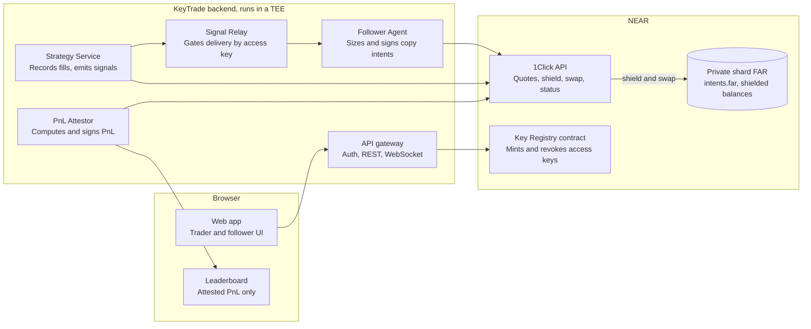

# KeyTrade / PrivateCopy: System Design Document

November 13, 2026

## 1. Overview

KeyTrade lets traders run strategies on NEAR's private shard while followers copy them automatically, so positions, sizes and timing never appear on a public chain. Only attested PnL is public.

**Problem.** On public chains, a profitable trader is copied, front-run or sandwiched the moment a position is visible. Existing copy-trading platforms solve this by being custodial and opaque, which makes track records unverifiable.

**Solution.** Three separable primitives, each mapped to a NEAR capability:

- **Private execution.** Trader and follower balances live on the Confidential Intents shard (`intents.far`). Swaps settle there with shielded balances.
- **Paid selective disclosure.** A trader sells time-limited access (a "viewing key" or subscription) that lets a follower's agent receive the strategy's signals.
- **Verifiable reputation.** A public leaderboard shows PnL computed from private activity, with an attestation that it was computed honestly.

**Goals**

- One end-to-end working flow: deposit to confidential, create a strategy, sell an access key, agent-triggered copy, public PnL attestation.
- Followers (human or AI agent) can copy with no manual trading.
- Position data is never public; only PnL and aggregate metrics are.
- Built on the existing 1Click API, not a custom bridge or relay.

**Non-goals (MVP)**

- Running our own private shard, solver or market-making network.
- Perps, leverage or derivatives; spot swaps only.
- Fiat on-ramps, KYC infrastructure, or a mobile app.
- Protection against a subscriber who deliberately leaks signals they legitimately received (see Section 11).

**Hackathon tracks.** Unstoppable DeFi, Privacy & Private AI, Agent Economy.

**Platform facts this design depends on**

- Confidential Intents settle on a private NEAR fork (FAR) run by a small permissioned validator set with no public networking; the RPC is private ([NEAR Intents docs](https://docs.near-intents.org/integration/market-makers/confidential-intents)).
- Public tokens are shielded into FAR as `imt:` wrapped balances through a Private PoA Bridge, and 1Click drives that bridge for you ([confidential liquidity guide](https://docs.near-intents.org/integration/market-makers/confidential-liquidity)).
- Confidential balances are readable only through 1Click with a user-session token; there is no public RPC for `intents.far`.
- From October 27, 2026, 1Click swaps are confidential-only, and the swap itself has no public NEAR hash ([changelog](https://docs.near-intents.org/changelog/entries/2026-10-27-1click-confidential.md)).

## 2. Actors and core flow

The MVP serves three actors and one automated role. Every flow below is one the demo must show.

| Actor | Goal | Key actions |
| --- | --- | --- |
| Trader (strategy owner) | Earn fees from a private edge | Shield funds, run strategy, set price and duration, issue and revoke access keys |
| Follower | Copy a trader without seeing or exposing anything public | Browse leaderboard, buy a key, set risk limits, fund a copy budget |
| Follower agent (NEAR AI) | Execute copies within the follower's limits | Receive signals, size, request quote, sign intent, report fills |
| Attestor (TEE service) | Prove PnL without revealing trades | Read trader's confidential balances, compute PnL, sign and publish |

**Core flow (the one demo path)**

1. **Shield.** Trader deposits USDC (or any 1Click-supported asset) into their confidential balance via a 1Click quote with `recipientType: CONFIDENTIAL_INTENTS`.
2. **Create strategy.** Trader registers a strategy: name, allowed assets, access price, key duration, max followers.
3. **Trade privately.** Trader's swaps execute on the private shard. The Strategy Service records each fill privately and emits an encrypted signal.
4. **Sell access.** Follower pays on NEAR. The Key Registry contract mints a time-limited access key bound to the follower's agent public key.
5. **Copy.** Follower's agent receives the signal, scales it to the follower's budget and risk limits, requests a confidential 1Click quote, signs the intent and submits it.
6. **Attest.** On a schedule, the Attestor reads the trader's private balances, computes PnL, and publishes a signed attestation. The public leaderboard shows only that.

**Out of the demo path:** key renewal, refunds, multi-asset strategies, disputes.

## 3. Architecture

The backend sits between the browser and NEAR, and holds every secret that must not be public: strategy signals, session tokens and agent keys. It runs inside a TEE so that even the platform operator cannot read signals.



The backend services call 1Click for all swaps and balance reads. Only the Key Registry is on public NEAR; the private shard holds all positions.

| Component | Responsibility | Trust assumption |
| --- | --- | --- |
| Web app | Wallet sign-in, trader dashboard, marketplace, follower setup | Untrusted client |
| API gateway | Auth, rate limits, REST and WebSocket entry point | Operator |
| Strategy Service | Records each trader fill, produces an encrypted signal | TEE |
| Signal Relay | Delivers signals only to holders of a valid, unexpired key | TEE; checks Key Registry |
| Follower Agent | Scales signals to the follower's budget and limits, signs intents | TEE or follower-run |
| PnL Attestor | Reads trader balances, computes PnL, signs attestations | TEE |
| Key Registry | Sells, mints, expires and revokes access keys on NEAR | Public contract |
| 1Click API | Quotes, shield and unshield, swap submission, status | NEAR Intents service |
| Private shard (FAR) | Shielded balances and confidential swap settlement | Permissioned validators |

**Design principles**

- **Signals are the only disclosure.** Nothing about positions leaves the backend except encrypted signals to key holders and aggregate PnL to the public.
- **Thin on-chain footprint.** Only key sales, expiries and attestation hashes touch public NEAR.
- **Pluggable disclosure.** Access control sits behind one interface, so a native viewing-key primitive can replace the app-layer one without changing the rest (Section 5).

## 4. Confidential execution layer

All custody and trading go through the 1Click API, which drives the Private PoA Bridge and the private shard. KeyTrade never calls the bridge or `intents.far` directly.

**How the layer works** ([docs](https://docs.near-intents.org/integration/market-makers/confidential-intents))

- Public tokens held in `intents.near` are *shielded*: transferred to a Treasury account, after which the bridge mints a matching wrapped balance on `intents.far`, named `imt:<treasury>:<public token id>`.
- Unshielding burns that balance and releases the backing tokens on NEAR.
- Your NEAR account id and signing key are the same on both contracts.
- Confidential balances cannot be read from a public RPC. They are read through 1Click with a user-session token, obtained by signing an empty intent ([balance guide](https://docs.near-intents.org/integration/market-makers/confidential-liquidity)).

**Operations KeyTrade uses**

| Operation | 1Click quote fields | Used for |
| --- | --- | --- |
| Shield from intents balance | `depositType: INTENTS`, `recipientType: CONFIDENTIAL_INTENTS`, `refundType: INTENTS` | Trader or follower funding |
| Shield from another chain | `depositType: ORIGIN_CHAIN`, `recipientType: CONFIDENTIAL_INTENTS` | First deposit from outside NEAR |
| Confidential swap | Fund from `CONFIDENTIAL_INTENTS` by submitting a signed transfer intent to the quote's deposit address | Strategy trades and copy trades |
| Unshield | `depositType: CONFIDENTIAL_INTENTS`, `recipientType: INTENTS`, `refundType: CONFIDENTIAL_INTENTS` | Withdrawals |
| Balance read | User-session token, entries with `source: private` | Dashboards and PnL attestation |

A shield is a swap of an asset into itself with the output routed to the confidential account, so `slippageTolerance: 0` is safe. Always run a quote with `dry: true` first, then a real quote to get the deposit address, then deposit, notify 1Click, and poll status ([quickstart](https://docs.near-intents.org/integration/distribution-channels/1click-api/quickstart/making-a-request.md)).

**Implications for the design**

- **Swaps leave no public trace.** Since October 27, 2026, 1Click swaps settle on the private shard with no public NEAR hash. Only the shield and unshield transfers are public, so deposit and withdrawal timing is the one visible signal about a trader (Section 11).
- **Copy vault accounts.** Each follower funds a dedicated NEAR account whose confidential balance is the copy budget. The follower agent holds a signing key for that account only, so the worst case from a compromised agent is the budget, not the follower's wallet.
- **Partner key.** The 1Click partner JWT from the [partner portal](https://partners.near-intents.org) stays server-side. Unauthenticated calls work but incur a 0.2% fee ([source](https://mpp.dev/payment-methods/nearintents/charge)).
- **Asset scope.** MVP supports USDC, NEAR and one or two majors, as listed by `GET /v0/tokens`.
- **Operator trust.** The shard is run by a small permissioned validator set (reported as seven) and bridged through a TEE-based bridge ([report](https://glitchwire.com/news/nears-confidential-intents-reaches-general-availability-bringing-privacy-infrast/)). Privacy here is only as strong as that set; the doc's threat model states this plainly.

## 5. Viewing keys and access model

The MVP sells time-limited access to a trader's signal stream, enforced at the application layer, and keeps a slot for a native viewing key if NEAR exposes one.

**Why two modes.** NEAR's launch coverage says users can hand viewing keys to auditors ([KuCoin News](https://www.kucoin.com/news/articles/near-enhances-cross-chain-privacy-with-confidential-intents-launch)). The integration docs I could read describe no app-facing API to issue, scope or expire one. So the design must not depend on it.

|  | Mode A: signal access (MVP) | Mode B: native viewing key (if available) |
| --- | --- | --- |
| What the buyer gets | Encrypted per-trade signals, relative sizes | Read access to the trader's confidential account |
| Expiry and revocation | Epoch key rotation; enforced by Relay and Key Registry | Depends on NEAR; likely needs account rotation |
| Scope control | Per strategy, per tier | All-or-nothing for that account |
| Leak tracing | Per-holder watermarking | None |
| Dependency risk | None beyond 1Click | Needs an undocumented primitive |

Both modes sit behind one `DisclosureProvider` interface (`grant`, `revoke`, `verify`, `stream`), so the Relay and agents never know which one is active.

**Mode A mechanics**

1. The Strategy Service holds an **epoch key** per strategy (symmetric, rotated every key duration or on any revocation).
2. Each signal is encrypted under the current epoch key.
3. When a follower buys access, the Key Registry records the grant. The Relay wraps the epoch key to the follower agent's public key (X25519) and delivers it.
4. Revocation or expiry removes the holder from the next epoch's wrap list. Signals already received stay readable, which is inherent to any copy-trading disclosure.

**Signal schema.** Sizes are relative so absolute positions never appear.

```json
{
  "strategy_id": "st_01",
  "seq": 142,
  "ts": "2026-11-13T22:41:07Z",
  "action": "swap",
  "sell_asset": "nep141:usdc",
  "buy_asset": "nep141:wrap.near",
  "size_bps_of_nav": 750,
  "max_slippage_bps": 50,
  "valid_until": "2026-11-13T22:46:07Z"
}
```

**Access key record (Key Registry)**

| Field | Meaning |
| --- | --- |
| `key_id` | Unique grant id |
| `strategy_id` | Strategy being accessed |
| `holder` | Follower NEAR account |
| `agent_pubkey` | Key the epoch key is wrapped to |
| `tier` | `live` or `delayed` (signals held back a set number of minutes, cheaper) |
| `expires_at` | Block timestamp after which no new epoch key is wrapped |
| `status` | `active`, `expired`, `revoked` |

**Pricing and payment.** A trader sets price and duration per tier. The follower pays in USDC on public NEAR through the Key Registry, which splits payment between trader and platform on purchase. The platform fee is a configurable parameter; the default in the MVP is 10%.

**Leak deterrence.** Each holder's copy of a signal carries a small unique perturbation (for example ±1 bp on `size_bps_of_nav`, and a holder-specific `seq` salt) so a leaked stream can be traced to a key id. Traders can also cap followers per strategy to limit crowding.

## 6. Copy-trade engine and agents

Each follower runs one agent per copied strategy. The signing path is deterministic code with a hard policy engine; an LLM is optional and never signs or sizes.

**Pipeline for one signal**

1. **Receive.** Decrypt the signal with the current epoch key. Drop it if `seq` was already processed or `valid_until` has passed.
2. **Check access.** Confirm the follower's key is `active` in the Key Registry.
3. **Size.** Convert relative size to the follower's own budget (formula below).
4. **Police.** Apply the follower's risk limits (table below). Any failure marks the copy `skipped` with a reason.
5. **Quote.** Request a confidential 1Click quote with `max_slippage_bps` from the signal.
6. **Sign and fund.** Sign a transfer intent from the copy vault account to the quote's deposit address.
7. **Settle.** Poll `GET /v0/status` until the swap succeeds, refunds or times out. Record the result.

```latex
size_{follower} = \min\left(\frac{bps_{signal}}{10000} \times NAV_{vault} \times m,\ cap_{trade}\right)
```

Here `m` is the follower's multiplier (default 1.0) and `cap_trade` is their per-trade limit. Because the signal carries only basis points of the trader's NAV, the follower never learns the trader's absolute position size.

**Follower risk controls**

| Control | Default | Effect when breached |
| --- | --- | --- |
| Per-trade cap | 20% of vault NAV | Reduce size to cap |
| Daily loss limit | 5% of vault NAV | Pause agent until next day |
| Max drawdown stop | 25% from peak | Pause and notify follower |
| Asset allowlist | Strategy assets only | Skip trade |
| Max slippage | Lower of signal and follower setting | Skip if quote exceeds it |
| Staleness | Signal `valid_until` | Skip trade |
| Kill switch | Off | Follower or key revocation halts all copying |

Defaults are starting values for the demo, not recommendations; followers can change them.

**Copy state machine.** `received` → `sized` → `quoted` → `funded` → `settled`, with terminal side states `skipped`, `refunded` and `failed`. Each transition is written to the follower's own log so a retry never double-trades: the idempotency key is `(key_id, strategy_id, seq)`.

**Where the NEAR AI agent fits**

- **Runs the loop.** Subscribes to the Relay, executes the pipeline above, holds the vault signing key inside its TEE or the follower's own runtime.
- **Optional LLM layer.** Explains skipped trades in plain language, drafts a weekly summary, and proposes limit changes. Proposals need follower approval; the policy engine remains the only authority on what is signed.
- **Self-hosted option.** The agent is a small, open service so advanced followers can run it on their own machine and never expose the vault key to the platform.

**Copy slippage metric.** The engine records the gap between the trader's fill price and the follower's. It is shown to followers and used to rank traders by *copyable* performance, not just headline PnL.

## 7. PnL attestation and leaderboard

The leaderboard ranks traders by time-weighted return computed inside a TEE from the trader's private balances. Rankings are public; positions and sizes are not.

**Data path.** Confidential balances are only readable through 1Click with a user-session token. The Attestor receives a short-lived session token for each strategy account, delivered encrypted by the trader's client at strategy registration and renewed each epoch. The Attestor takes a balance snapshot on a fixed schedule (hourly in the MVP), prices it with a pinned price source, and stores only the derived numbers plus a hash of each snapshot.

**Method: time-weighted return.** Deposits and withdrawals are the main way to fake a good record, so returns are computed per period and chained, with external flows removed. Shield and unshield transfers are the only public events, so the Attestor sees every external flow.

```latex
r_i = \frac{V_i - F_i}{V_{i-1}} - 1, \qquad TWR = \prod_i (1 + r_i) - 1
```

Here `V` is vault value in USD at the period end and `F` is the net external flow in that period.

**What an attestation contains**

| Field | Public? | Notes |
| --- | --- | --- |
| `strategy_id`, period start and end | Yes | Fixed windows: 7d, 30d, all-time |
| `twr_bps` | Yes | Time-weighted return |
| `max_drawdown_bps` | Yes | Peak-to-trough in the window |
| `nav_bucket` | Yes | Rounded band (for example $10k to $50k), not the exact value |
| `trade_count_bucket` | Yes | Banded, not exact |
| `snapshot_root` | Yes | Merkle root of snapshot hashes, anchored on NEAR |
| `tee_quote`, `signature` | Yes | Remote attestation of the Attestor build plus its signature |
| Per-trade data, exact balances | No | Never leave the Attestor |

The root is posted to an Attestation contract on NEAR so history cannot be rewritten. Anyone can verify the signature and TEE quote against the published Attestor build hash.

**Anti-gaming rules**

- **One account per strategy**, fixed at registration. A strategy cannot swap in a new account after a bad run.
- **Minimum track record** (default 14 days and 10 trades) before appearing on the board.
- **Flows normalised** by the TWR method; a large withdrawal flags the strategy for review rather than boosting it.
- **Risk-adjusted rank.** Default sort is return divided by drawdown, not raw return.
- **Copier PnL.** A second column shows aggregate follower results, shown only with at least 5 active followers so no individual follower is exposed.

**What the attestation does not prove.** It proves the computation ran as published on the balances 1Click reported. It does not prove 1Click's data is honest. Zero-knowledge proofs over the snapshots are listed under future work (Section 15).

## 8. Smart contracts on NEAR

Three small Rust contracts (near-sdk) hold everything that must be public and tamper-proof: what is for sale, who has paid, and what was attested. No contract ever sees a position or a trade.

| Contract | Purpose | Key methods |
| --- | --- | --- |
| `strategy-market` | Lists strategies and their pricing; holds the platform fee setting | `register_strategy`, `update_pricing`, `pause_strategy`, `get_strategy` |
| `key-registry` | Sells access, records grants, supports revocation and expiry | `ft_on_transfer` (purchase), `revoke`, `get_key`, `keys_for_strategy` |
| `attestation` | Stores signed PnL attestation hashes and the Attestor's public key and build hash | `post_attestation`, `rotate_attestor`, `get_latest` |

**Purchase flow.** The follower sends USDC to `key-registry` with `ft_transfer_call`, passing `strategy_id`, `tier` and `agent_pubkey` in the message. `ft_on_transfer` checks the price and the follower cap, mints the key record, and splits the payment between the trader and the platform in the same call. Excess payment is returned.

**Key rules**

- Duration is fixed at purchase; there is no auto-renew in the MVP.
- A trader can `revoke` a single key, with a pro-rata refund of unused time paid from the trader's side. A platform admin can pause a strategy but cannot read signals or move trader funds.
- Keys are non-transferable so a buyer cannot resell access.
- The Relay and agents read key status through view calls, so checks cost no gas.

**Events.** All state changes emit NEP-297 events (`key_granted`, `key_revoked`, `key_expired`, `attestation_posted`) so the backend indexes from the chain rather than polling.

**Admin and upgrade.** A 2-of-3 multisig owns the platform fee and Attestor key. Contracts are upgradeable behind the multisig during the hackathon and frozen before any real-value launch.

**Storage.** Each key record is a few hundred bytes, paid for by the buyer through a small deposit returned on expiry cleanup.

## 9. Data model and storage

Postgres is the system of record for off-chain state, Redis streams carry signals to agents, and anything sensitive is encrypted before it is stored. The chain is the source of truth for keys and attestations; the database mirrors it through the event indexer.

| Entity | Key fields | Sensitivity |
| --- | --- | --- |
| `user` | `near_account`, `role`, `created_at` | Public |
| `strategy` | `strategy_id`, `owner`, `vault_account`, `assets[]`, `pricing`, `status` | Public |
| `access_key` (chain mirror) | `key_id`, `strategy_id`, `holder`, `agent_pubkey`, `tier`, `expires_at`, `status` | Public |
| `epoch` | `strategy_id`, `epoch_no`, `starts_at`, `wrapped_keys[]` | Wrapped keys only; raw key never stored |
| `signal` | `strategy_id`, `seq`, `ciphertext`, `ts` | Encrypted |
| `fill` (trader) | `strategy_id`, `seq`, `asset_in`, `asset_out`, `amount_in`, `amount_out`, `ts` | Secret; stays inside the TEE |
| `copy_order` | `key_id`, `seq`, `state`, `skip_reason`, `quote_id`, `status_ref` | Private to follower |
| `follower_settings` | `key_id`, `multiplier`, `trade_cap`, `daily_loss`, `drawdown_stop` | Private to follower |
| `snapshot` | `strategy_id`, `ts`, `value_usd`, `hash` | Secret; only the hash leaves |
| `attestation` | `strategy_id`, `window`, `twr_bps`, `drawdown_bps`, `root`, `tx_hash` | Public |

**Storage rules**

- Secret tables live in a database reachable only from inside the TEE, encrypted at rest with a key sealed to the enclave.
- The public API serves only the public tables. There is no code path from the gateway to `fill` or `snapshot`.
- Session tokens and agent keys are held in the enclave's sealed storage, never in Postgres or logs.
- Signals are kept for the longest key duration plus 30 days, then deleted. Fills and snapshots are kept for the attestation window needed to recompute any published figure.
- Every external identifier shown in logs is truncated or hashed.

## 10. API design

The public API is REST plus one WebSocket for signals. Auth is a NEAR account signature, so there are no passwords.

**Authentication.** The client signs a server-issued nonce with its NEAR key (NEP-413 message signing) and receives a short-lived JWT. Signal streaming additionally requires the follower agent to prove possession of the `agent_pubkey` registered on its key.

| Method and path | Auth | Purpose |
| --- | --- | --- |
| `GET /v1/leaderboard` | None | Ranked strategies with latest attestations; filters by window and asset |
| `GET /v1/strategies/{id}` | None | Public strategy page: pricing, attestation history, follower count |
| `POST /v1/auth/nonce`, `POST /v1/auth/verify` | None | Sign-in with NEAR signature |
| `POST /v1/vault/shield` | Trader or follower | Creates a 1Click shield quote and returns the deposit instructions |
| `POST /v1/vault/unshield` | Trader or follower | Starts a withdrawal to a public account |
| `GET /v1/vault/balance` | Owner | Confidential balances for the caller's vault, read through 1Click |
| `POST /v1/strategies` | Trader | Registers a strategy and its vault account |
| `POST /v1/strategies/{id}/trades` | Trader | Submits a trade; Strategy Service quotes, signs, records the fill and emits the signal |
| `GET /v1/keys` | Owner | Keys the caller holds or has sold |
| `POST /v1/keys/{id}/revoke` | Trader | Triggers on-chain revocation and epoch rotation |
| `PUT /v1/copy/{key_id}/settings` | Follower | Updates risk limits and multiplier |
| `GET /v1/copy/{key_id}/orders` | Follower | Copy order history and skip reasons |
| `POST /v1/copy/{key_id}/pause` | Follower | Kill switch |
| `WS /v1/signals/{strategy_id}` | Key holder | Encrypted signal stream with the wrapped epoch key |

**Conventions**

- JSON everywhere; amounts as strings in smallest units to avoid float errors.
- Idempotency-Key header on every POST that moves value; repeats return the original result.
- Errors use one shape: `{ "code", "message", "retryable" }`.
- WebSocket messages carry `seq`; on reconnect the client sends its last `seq` and the Relay replays missed signals still within `valid_until`.
- Rate limits: public reads 60 per minute per IP, authenticated writes 20 per minute per account.

**Signal frame (WebSocket)**

```json
{
  "type": "signal",
  "strategy_id": "st_01",
  "epoch": 7,
  "seq": 142,
  "wrapped_epoch_key": "base64...",
  "ciphertext": "base64...",
  "nonce": "base64..."
}
```

## 11. Security, privacy and threat model

The platform hides positions from the public and from non-subscribers. It does not hide them from the private shard's validators, from subscribers who legitimately receive signals, or from the TEE if the TEE is broken. The claims below stay inside those limits.

**Who can see what**

| Party | Sees | Does not see |
| --- | --- | --- |
| General public | Leaderboard attestations, key sales, shield and unshield transfers | Trades, sizes, timing, balances |
| Key holder | Relative-size signals for strategies they paid for | Trader's absolute NAV, other strategies |
| Platform operator | Public data and ciphertexts | Plaintext signals or fills, if the TEE holds |
| Private shard validators | Everything on the shard | n/a (trusted) |
| Solvers quoting swaps | Quote requests they receive, so pair and size of the swap | Who the trader or follower is beyond the account id in the request |

**Leakage channels to design around**

- **Public key purchases** reveal which account follows which strategy. Mitigation: followers can buy from a fresh account funded by an unshield, with the cost of weaker continuity.
- **Shield and unshield timing** reveals when a trader adds or removes capital. Mitigation: batch withdrawals on a fixed schedule; round deposit sizes in the UI where possible.
- **Signal timing.** A follower who sees a signal can trade the same asset publicly before the trader's price moves. The `delayed` tier and relative sizes reduce, but do not remove, this.
- **Leaks by subscribers.** A subscriber can republish signals. Per-holder watermarks make the leaker traceable but cannot prevent the leak.
- **Quote metadata.** Solver-visible fields are out of KeyTrade's control; document them to users.

**Threats and mitigations**

| Threat | Impact | Mitigation |
| --- | --- | --- |
| Trader pumps a thin asset and exits into copiers | Follower loss | Liquid-asset allowlist, per-trade cap, slippage limit, copy-slippage metric on the board |
| Fake track record via deposits or self-copying | Misleading rank | TWR with flows removed, one account per strategy, minimum track record, copier-PnL threshold of 5 followers |
| Agent key compromised | Loss of copy budget | Dedicated vault account; budget is the maximum loss |
| Session token stolen | Balance read, not spend | Short expiry, sealed storage, rotation each epoch |
| TEE compromise | All signals exposed | Published build hash, remote attestation, key rotation, minimal data held in the enclave |
| Contract bug in `key-registry` | Stolen or locked payments | Small funds at risk in the MVP, audit before real value, multisig pause |
| Replay of an old signal | Duplicate trade | `seq` and `valid_until` checks, idempotency key |
| Prompt injection into the LLM layer | Bad advice shown | LLM output never reaches signing; approval needed for any limit change |

**Out of scope for the MVP:** defending against a compromised private-shard validator set, network-level traffic analysis, and legal compliance beyond the notes in Section 15.

## 12. Frontend and UX

A single Next.js (TypeScript) app with a NEAR wallet selector. Privacy has to be visible in the interface, so every screen says what is public and what is private.

| Screen | Audience | What it shows | Key interaction |
| --- | --- | --- | --- |
| Leaderboard | Anyone | Ranked strategies, TWR, drawdown, NAV band, follower count, attestation badge | Filter by window and asset; open a strategy |
| Strategy page | Anyone | Attestation history chart, pricing, tiers, key duration | Buy access |
| Vault | Trader and follower | Public and confidential balances side by side, shield and unshield | Shield funds, withdraw |
| Trader studio | Trader | Strategy settings, trade ticket, follower count, earnings, key list | Place a trade, revoke a key |
| Copy setup | Follower | Budget, multiplier, risk limits, agent status | Fund vault, start or pause the agent |
| Copy activity | Follower | Orders with state, skip reasons, copy slippage, vault PnL | Inspect an order |

**UX rules**

- **Privacy labels everywhere.** Each number carries a small badge: *public*, *private to you*, or *attested*. Nothing private is ever rendered in a shared or screenshot-friendly view without a warning.
- **Shield flow in one step.** The vault screen hides the three-call 1Click sequence behind a single confirm, with a progress state fed by `GET /v0/status`.
- **Plain language for risk.** The copy setup screen shows worst-case loss as a dollar figure (the vault budget) before the follower confirms.
- **Attestation you can verify.** The badge opens a panel with the signature, TEE quote and on-chain root, and a one-click check.
- **Agent transparency.** Every skipped or reduced trade shows the rule that caused it.

**Stack.** Next.js with TypeScript, NEAR wallet selector for sign-in and payments, TanStack Query for data, a charting library for attestation history, WebSocket client for live order status. Hosted on Vercel or any static edge host; no secrets in the client.

**Demo mode.** A seeded testnet strategy with a time-compressed attestation feed so the leaderboard and copy flow can be shown without waiting days (Section 14).

## 13. Infrastructure and operations

The MVP runs as five containerised services plus Postgres and Redis. The three that touch secrets run in a TEE; the rest are ordinary cloud workloads.

| Service | Stack | Runs in | Scales by |
| --- | --- | --- | --- |
| API gateway | Node.js (Fastify) | Standard container | Replicas behind a load balancer |
| Strategy Service | TypeScript | TEE | One worker per active strategy |
| Signal Relay | TypeScript, Redis streams | TEE | Replicas; sticky by strategy |
| Follower Agent runtime | TypeScript | TEE, or follower-run | One instance per follower per strategy |
| PnL Attestor | TypeScript or Rust | TEE | One worker per scheduled batch |
| Event indexer | TypeScript | Standard container | Single consumer per contract |

**TEE hosting.** Use a confidential-compute environment that supports remote attestation (NEAR AI's TEE-backed cloud, or a cloud confidential VM). Each TEE service has a reproducible build, and its hash is published in the `attestation` contract so users can verify what is running. Which provider is used is an open question (Section 15).

**Environments**

- **Local.** Docker Compose, a NEAR sandbox for contracts, and mocked 1Click responses recorded from real calls.
- **Testnet.** Contracts on NEAR testnet with the real 1Click API for the shield, swap and status path as far as it is available to test accounts.
- **Mainnet (demo).** Small-balance accounts, a capped number of followers, feature-flagged.

**CI and delivery.** GitHub Actions runs contract tests (near-workspaces), service tests and a lint step on every push. Contract deploys are manual through the multisig. Container images are built reproducibly and tagged with their hash.

**Observability**

- Structured logs with no amounts or account ids for secret flows (counts and error codes only).
- Metrics: signal-to-fill latency, copy success rate, 1Click quote failure rate, attestation lag, WebSocket reconnects.
- Alerts: attestation older than two hours, indexer behind by more than 20 blocks, 1Click error rate above threshold, TEE quote verification failure.

**Failure handling**

- **1Click unavailable.** Trades queue for the signal's `valid_until` window, then are skipped; the board shows a status banner.
- **Relay down.** Agents reconnect and replay from last `seq`.
- **Attestor down.** Leaderboard shows the last attestation with its age; it is never back-filled with guesses.

**Cost drivers.** TEE instances, Postgres, and the 1Click partner fee (0.2% on unauthenticated calls, reduced with a partner key). No figure here is a quote; it should be priced against the chosen TEE provider.

## 14. Build plan and demo

Build in five phases ordered by risk: the 1Click path and key delivery come first, because everything else depends on them. No dates are fixed here because the hackathon schedule and team size are not given.

```mermaid
flowchart LR
  P1["1 Foundation<br/>Wallet sign-in<br/>Shield, unshield<br/>Read balances"] --> G1{{"Gate: shielded funds<br/>read back"}}
  G1 --> P2["2 Strategy<br/>Register strategy<br/>Trade ticket<br/>Encrypted signals"]
  P2 --> G2{{"Gate: signal decrypts<br/>on 2nd account"}}
  G2 --> P3["3 Access<br/>Key Registry<br/>USDC purchase<br/>Epoch key wrap"]
  P3 --> G3{{"Gate: key purchase<br/>opens the stream"}}
  G3 --> P4["4 Copy agent<br/>Receive signals<br/>Size and police<br/>Sign, fund, settle"]
  P4 --> G4{{"Gate: copy swap settles<br/>on private shard"}}
  G4 --> P5["5 Proof, demo<br/>Attestor, board<br/>Seeded demo data<br/>Rehearsal"]
  P5 --> G5{{"Gate: full demo runs<br/>end to end"}}
```



Phase 4, the copy agent, is the demo's core. If time runs short, cut from the list below, never from phases 1 to 4.

**Day-one spikes (each can change the plan)**

- Confirm the exact 1Click request for a swap funded from a confidential balance. The page that documents it was not readable when this was written, so the shape in Section 4 is inferred from the quote reference.
- Confirm how the user-session token is obtained, how long it lives, and whether it can be handed to the Attestor.
- Confirm which assets and which network (testnet or mainnet) support confidential swaps for test accounts.
- Check whether any app-facing viewing-key API exists (decides Mode A only or Mode A plus B).

**Cut list, first to go**

| Order | Feature | Fallback |
| --- | --- | --- |
| 1 | LLM summaries and limit suggestions | Omit; rules engine only |
| 2 | Native viewing-key mode (Mode B) | Mode A only |
| 3 | Delayed tier | Live tier only |
| 4 | Copier PnL column | Omit |
| 5 | Self-hosted agent option | Platform-hosted agent only |
| 6 | Unshield screen | Script or CLI for withdrawals |
| 7 | On-chain attestation root | Signed API response with TEE quote |

**Demo script (about 5 minutes)**

1. Open the leaderboard and show a strategy's attested return and NAV band, with no positions visible.
2. As trader: shield USDC, show public and private balances side by side.
3. Place a private swap; show that the explorer has no public swap record.
4. As follower: buy a key and set a budget and limits.
5. Trigger a second trader swap; watch the follower agent size, sign and settle its copy, with copy slippage shown.
6. Revoke the key; the next signal never arrives. Open the attestation panel and verify the signature and on-chain root.

**Acceptance checks**

- A shielded balance is read back through 1Click with the user-session token.
- An account without a key cannot decrypt a signal.
- An expired or revoked key stops receiving the next epoch.
- A copy trade never exceeds the follower's per-trade cap or vault budget.
- An attestation signature and TEE quote verify, and the posted root matches.

Any seeded or time-compressed data shown in the demo is labelled *demo data* in the interface.

## 15. Risks, open questions and future work

The largest risk is that the viewing-key idea depends on a primitive that may not be exposed to apps; the design survives that by selling signal access instead.

**Open questions**

| # | Question | Why it matters | Decided by |
| --- | --- | --- | --- |
| 1 | Does NEAR expose an app-facing viewing key for confidential accounts? | Decides Mode A only or Mode A plus B | Day-one spike, NEAR team |
| 2 | How is the user-session token issued, scoped and expired? | The Attestor depends on being able to read balances | Day-one spike |
| 3 | Do confidential swaps run on testnet for test accounts? | Sets the testing and demo environment | Day-one spike |
| 4 | Which TEE host: NEAR AI's cloud or a cloud confidential VM? | Cost, attestation tooling, who is trusted | Team choice |
| 5 | Are signal pricing and the 10% platform fee right? | Trader and follower economics | Product choice |
| 6 | Should followers be able to buy keys privately? | Removes the public follower-to-strategy link | Product choice |

**Risks**

- **Platform dependency.** 1Click is a single service in front of the bridge and shard. An API change or outage stops trading; the design queues and skips rather than guessing.
- **Validator trust.** Privacy rests on a small permissioned validator set and a TEE-based bridge. Users must be told this plainly.
- **TEE attacks.** Side-channel and supply-chain attacks on TEEs are a known class. Mitigated by minimal enclave data and key rotation, not eliminated.
- **Thin liquidity.** Copying into small markets moves price against followers. The asset allowlist and slippage caps address it only partly.
- **Regulatory.** Selling trading signals, running a copy-trading service and operating private-execution tooling can fall under investment-advice, portfolio-management or money-transmission rules depending on the country. This document is not legal advice; a lawyer should review before any real-money launch, and the demo should use small balances and clear risk disclosures.

**Future work**

- Zero-knowledge proofs over balance snapshots so attestation no longer relies on the TEE.
- Native viewing keys (Mode B) and per-strategy scoped read access.
- Multi-chain strategies using Chain Signatures.
- Perps and leveraged products once confidential support exists.
- Strategy tokens or revenue sharing for traders.
- A marketplace for third-party risk-management agents.

**Sources**

- [Confidential Intents architecture](https://docs.near-intents.org/integration/market-makers/confidential-intents), NEAR Intents docs
- [Moving balances into confidential accounts](https://docs.near-intents.org/integration/market-makers/confidential-liquidity), NEAR Intents docs
- [1Click swaps roll out as confidential only](https://docs.near-intents.org/changelog/entries/2026-10-27-1click-confidential.md), changelog, October 27, 2026
- [1Click quote reference](https://docs.near-intents.org/api-reference/oneclick/request-a-swap-quote.md) and [making a request](https://docs.near-intents.org/integration/distribution-channels/1click-api/quickstart/making-a-request.md)
- [Confidential Intents reaches general availability](https://glitchwire.com/news/nears-confidential-intents-reaches-general-availability-bringing-privacy-infrast/), Glitchwire (validator count, TEE bridge)
- [NEAR Confidential Intents launch coverage](https://www.kucoin.com/news/articles/near-enhances-cross-chain-privacy-with-confidential-intents-launch), KuCoin News (viewing keys, Chain Signatures)
- [NEAR Intents charge method](https://mpp.dev/payment-methods/nearintents/charge), mpp.dev (partner JWT and 0.2% unauthenticated fee)

Facts about NEAR were taken from search extracts of these pages on November 13, 2026, not from full page reads, and the 1Click confidential-swap page could not be opened. Treat Section 4 request shapes as inferred until the day-one spikes confirm them.